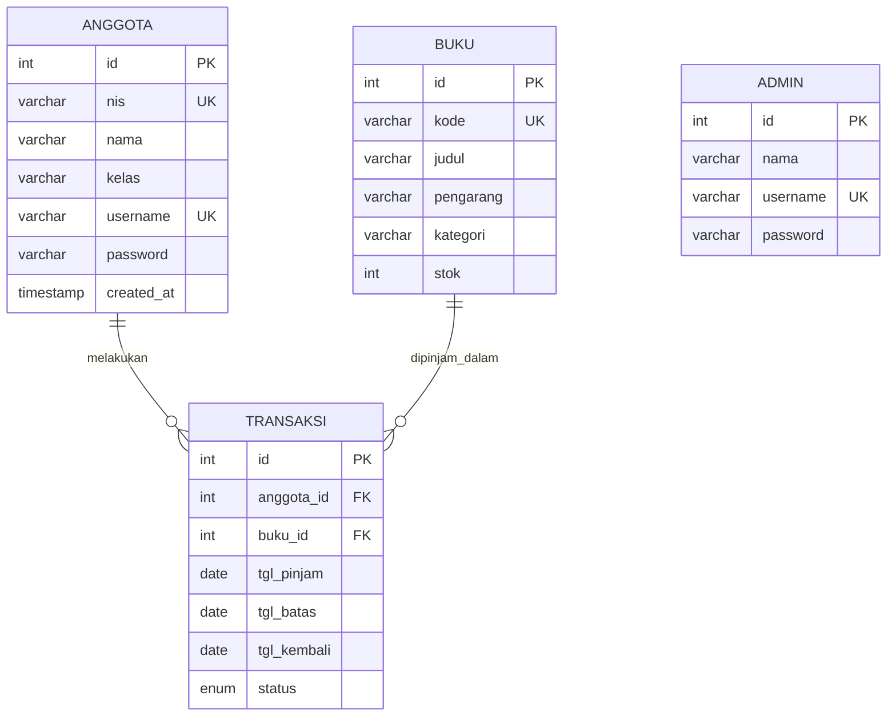

# Dokumentasi Aplikasi Perpustakaan Sekolah Digital (UKK RPL 2025/2026 – Paket 4, KM25.4.1.1)

## 1. ERD

Relasi: satu anggota dan satu buku dapat memiliki banyak transaksi (FK `ON DELETE RESTRICT` agar riwayat tidak yatim). Tabel `admin` berdiri sendiri (autentikasi).
Salin blok mermaid ke https://mermaid.live untuk dijadikan gambar ERD pada laporan Word.

## 2. Deskripsi Program
Aplikasi web lokal (localhost, tanpa internet saat operasional) dengan **Next.js App Router + TypeScript + Tailwind CSS + MySQL (Laragon)**.
Arsitektur: *Server Components* (halaman) → *Server Actions* (`src/app/actions.ts`) → *Service* (`src/lib/services.ts`, logika transaksi) → *DB* (`src/lib/db.ts`, prepared statement). Sesi: cookie httpOnly ditandatangani HMAC (`src/lib/auth.ts`); password di-hash bcrypt.
Alur sesuai flowmap: login pilih Admin/Siswa → (siswa belum anggota → Daftar) → validasi → dashboard → menu. Admin: Buku, Transaksi, Anggota (CRUD). Siswa: Peminjaman & Pengembalian + pencarian.
Pemetaan kriteria PPsp: struktur data/array (1.1, 1.11: `ids` array di `prosesPinjam`, `rows.map`), prosedur & fungsi (1.10), akses file (1.12: `logs/aktivitas.log`, ekspor CSV), dokumentasi fungsi (1.14), debugging/uji (1.17–1.23).

## 3. Modul, Fungsi & Prosedur
| Modul | Fungsi | Parameter | Proses | Return |
|---|---|---|---|---|
| lib/db.ts | `query` | sql, params[] | Prepared statement via pool | array baris / ResultSetHeader |
| lib/auth.ts | `setSession` | Session | Buat cookie bertanda tangan HMAC | void |
| | `getSession` | – | Verifikasi tanda tangan cookie | Session \| null |
| | `requireRole` | role | Guard; redirect ke login bila tak sesuai | Session |
| | `clearSession` | – | Hapus cookie | void |
| lib/services.ts | `prosesPinjam` | anggotaId, bukuId | Transaksi DB: cek batas 3 buku & duplikat, `stok-1` bila stok>0, insert transaksi (batas 7 hari) | {ok, pesan} |
| | `prosesKembali` | transaksiId, anggotaId? | Kunci baris, set Dikembalikan, `stok+1` | {ok, pesan} |
| | `ambilTransaksi` | q, status | JOIN transaksi-anggota-buku + filter | array baris |
| | `logAktivitas` | teks | Append ke logs/aktivitas.log | Promise\<void\> |
| actions.ts | `login` | FormData(role,username,password) | Cek bcrypt, set sesi, redirect | redirect |
| | `logout`, `daftar` | FormData | Hapus sesi / validasi + insert anggota (hash) | redirect |
| | `simpanBuku`, `hapusBuku` | FormData | Create/Update/Delete buku | redirect+pesan |
| | `simpanAnggota`, `hapusAnggota` | FormData | Create/Update/Delete anggota | redirect+pesan |
| | `pinjamBuku`, `kembalikanBuku`, `adminPinjam`, `hapusTransaksi` | FormData | Memanggil service / hapus riwayat berstatus Dikembalikan | redirect+pesan |
| admin/transaksi/export/route.ts | `GET` | Request (q,status) | Susun CSV dari `ambilTransaksi` | Response file CSV |

## 4. Skenario Uji Coba (Black-Box)
Data uji: admin/admin123; andi, siti, budi / siswa123. *Kolom Hasil diisi setelah Anda menjalankan pengujian.*
| No | Fitur | Data uji | Hasil diharapkan | Hasil |
|---|---|---|---|---|
| 1 | Login Admin | admin / admin123 | Masuk Dashboard Admin | ☐ |
| 2 | Login Admin gagal | admin / salah | Pesan "Username atau password salah" | ☐ |
| 3 | Login Siswa | andi / siswa123 | Masuk Dashboard Siswa | ☐ |
| 4 | Akses tanpa login | buka /admin/buku | Dialihkan ke login | ☐ |
| 5 | Daftar anggota | NIS 1004, user "dina", pw 123456 | Berhasil, kembali ke login | ☐ |
| 6 | Daftar duplikat | username "andi" | Pesan NIS/username sudah terdaftar | ☐ |
| 7 | Tambah buku | B006, stok 3 | Muncul di daftar | ☐ |
| 8 | Ubah & hapus buku | ubah stok; hapus B006 | Data berubah; terhapus | ☐ |
| 9 | Hapus buku bertransaksi | hapus B001 | Ditolak dengan pesan | ☐ |
| 10 | CRUD anggota | tambah/ubah/hapus | Sesuai | ☐ |
| 11 | Pinjam (siswa) | siti pinjam B002 | Sukses; stok B002 berkurang 1 | ☐ |
| 12 | Pinjam stok habis | buku stok 0 | Tombol "Habis"/ditolak | ☐ |
| 13 | Pinjam >3 buku | andi pinjam buku ke-4 | Ditolak (maks 3) | ☐ |
| 14 | Kembalikan | andi kembalikan B001 | Status Dikembalikan; stok +1 | ☐ |
| 15 | Pencarian | "laskar", kategori Novel, hanya tersedia | Hasil terfilter | ☐ |
| 16 | Ekspor CSV | klik Ekspor CSV | File laporan_transaksi.csv terunduh | ☐ |

## 5. Dokumentasi Debugging
| Bug | Penyebab | Perbaikan |
|---|---|---|
| Stok buku bisa negatif saat dua siswa pinjam bersamaan | Cek stok & update dipisah (race condition) | `UPDATE ... SET stok=stok-1 WHERE id=? AND stok>0` + cek `affectedRows`, dibungkus transaksi; plus `CHECK (stok>=0)` |
| Hapus anggota/buku gagal dengan error FK | Masih ada riwayat transaksi | `try/catch` dan pesan ramah; FK `RESTRICT` dipertahankan demi integritas |
| Query `LIKE` gagal pada parameter `LIMIT`/array | `execute()` MySQL2 ketat terhadap tipe | Hindari parameter LIMIT; gunakan `Array(n).fill('%q%')` untuk LIKE |
| Redirect di dalam `try/catch` ikut tertangkap | `redirect()` melempar exception khusus | Panggil `go()` di luar blok `try` |

## 6. Manual Pengguna
**Instalasi (Laragon):** (1) Start Apache/MySQL di Laragon. (2) Impor `database/perpustakaan.sql` via HeidiSQL/phpMyAdmin. (3) Sesuaikan `.env.local`. (4) `npm install` (sekali, perlu internet), lalu `npm run build && npm start` atau `npm run dev`. (5) Buka http://localhost:3000.
**Admin:** Login sebagai Admin → Dashboard → *Kelola Buku* (isi form lalu Tambah; *Ubah* mengisi form; *Hapus*; cari di kolom pencarian) → *Kelola Anggota* (sama) → *Transaksi* (pilih anggota & buku → Proses Peminjaman; *Kembalikan*; filter; *Ekspor CSV*) → Logout.
**Siswa:** Belum punya akun → *Daftar anggota* → Login sebagai Siswa → *Peminjaman Buku* (cari/filter, klik Pinjam; maks 3 buku, 7 hari) → *Pengembalian Buku* (klik Kembalikan) → Logout.

## 7. Laporan Evaluasi Singkat
**Tercapai:** seluruh alur flowmap Admin & Siswa, CRUD buku/anggota/transaksi, pencarian, akses file (log & CSV), validasi dan keamanan dasar (bcrypt, prepared statement, sesi bertanda tangan, guard role).
**Kekurangan:** belum ada upload cover buku, denda keterlambatan, dan pengujian otomatis; paginasi belum ada.
**Pengembangan:** denda, notifikasi jatuh tempo, ekspor PDF, unit test.

## 8. Pembaruan Fitur
Tambahan: **upload cover buku** (`simpanCover` di actions.ts: validasi JPG/PNG/WEBP ≤ 2 MB, simpan ke `uploads/`, file lama dihapus saat diganti/dihapus; disajikan via route `/cover/[file]`), **denda keterlambatan** (`hitungDenda(batas, kembali?)` → {hari, denda}, Rp1.000/hari; tampil di Transaksi, Pengembalian, Riwayat, dan CSV), **Riwayat siswa** (`/siswa/riwayat`). Kolom baru: `buku.cover VARCHAR(255) NULL` (impor ulang `perpustakaan.sql`).
Uji tambahan: 17) upload cover PNG 1 MB → tampil di daftar & katalog; 18) upload file .pdf / >2 MB → ditolak; 19) buku terlambat 3 hari → denda Rp3.000; 20) siswa buka Riwayat → semua transaksi miliknya tampil.
